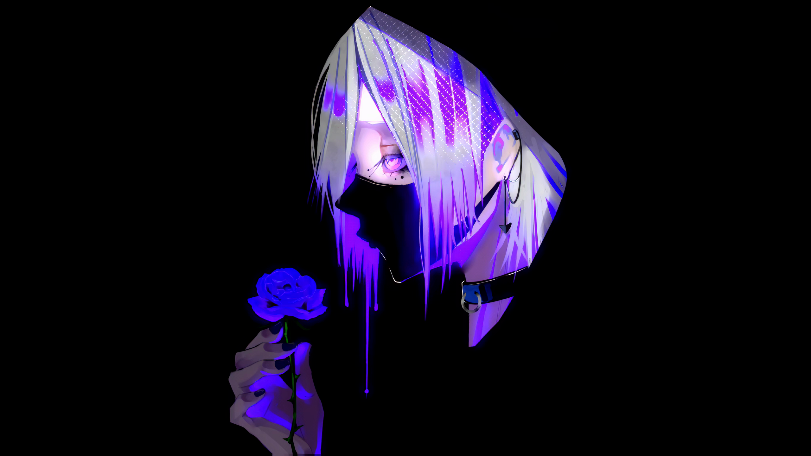

# Ultraviolet — an Omarchy theme

Pure black and purple theme for [Omarchy](https://omarchy.org/), built around a
gothic neon-purple live wallpaper. True black (`#000000`) surfaces, vivid violet
accents, lavender text, and a purple gradient on window borders.



## Palette

| Token | Color |
| --- | --- |
| Background / darker background | `#000000` |
| Panels / selection | `#150a24` / `#2a1247` |
| Accent | `#a855f7` |
| Foreground | `#e9e1f7` |
| Muted | `#6f5b8f` |
| Active border | `#a855f7` → `#e9e1f7` gradient |
| Inactive border | `#1a1026` |

The ANSI palette stays inside the purple spectrum so terminals, btop, git diffs
and Neovim all match: rose `#ff5f8f`, orchid `#d478ff`, violet `#a878ff`,
periwinkle `#7aa2ff`, indigo `#5b4bff`.

## Install

```bash
omarchy theme install https://github.com/milky86x/omarchy-ultraviolet-theme.git
```

This clones the theme to `~/.config/omarchy/themes/ultraviolet` and applies it.

Or install manually:

```bash
git clone https://github.com/milky86x/omarchy-ultraviolet-theme.git \
  ~/.config/omarchy/themes/ultraviolet
omarchy theme set ultraviolet
```

## What's in the box

- `colors.toml` — the full palette, which Omarchy renders into the terminal,
  browser, editor, btop, Hyprland border and shell configs.
- `shell.bar.toml` — bar-only override so the top bar text uses the purple
  accent instead of the default lavender foreground.
- `icons.theme` — uses `Yaru-purple-dark` (from `yaru-icon-theme`).
- `backgrounds/` — the animated purple live wallpaper.
- `preview.png` — still frame used by the theme switcher.

## Notes

- The bar text is `#a855f7`; the `active` attention token (recording, updates)
  is rose `#ff5f8f`. Popups, tooltips and the launcher keep the lavender
  foreground `#e9e1f7`.
- The wallpaper is bundled for convenience; all rights belong to its original
  creator.
